<h1 align="center">Hey, I'm Justin 👋</h1>

  <b>Software Developer Intern at IBM</b> · Computer Science at Western University

  I build developer tools, AI systems, and production software.

  
  
  
  

  

## What I'm working on

- Software development at **IBM**
- [**JStack**](https://github.com/JustinPrograms/jstack), portable planning, implementation, and review workflows for Claude Code, Codex, and IBM Bob
- **Mark**, feature and bug-fix work on IBM Skills Network's assessment platform
- **Ayori**, a private knowledge-capture system for mainframe codebases using TypeScript, PostgreSQL, pgvector, AWS Bedrock, and Zowe

## Featured work

<table>
  <tr>
    <td width="50%" valign="top">
      <h3><a href="https://github.com/JustinPrograms/jstack">JStack</a></h3>
      Portable planning, implementation, testing, and review workflows for Claude Code, Codex, and IBM Bob.
        
      <a href="https://github.com/JustinPrograms/jstack"><b>Explore JStack →</b></a>
    </td>
    <td width="50%" valign="top">
      <h3>Mark · IBM Skills Network</h3>
      Contributed open-source features and bug fixes to IBM Skills Network's assessment platform; the repository is now private.
    </td>
  </tr>
  <tr>
    <td width="50%" valign="top">
      <h3><a href="https://github.com/JustinPrograms/RiskGuard">RiskGuard</a></h3>
      Real-time fraud detection with LightGBM, ONNX, and Triton inference.
        
      <a href="https://github.com/JustinPrograms/RiskGuard"><b>Explore RiskGuard →</b></a>
    </td>
    <td width="50%" valign="top">
      <h3>Guardian AML</h3>
      An in-development MVP exploring machine learning for anti-money laundering on LinuxONE using IBM synthetic datasets. The repository is private.
    </td>
  </tr>
</table>

## A bit about me

- Fourth-year Computer Science student at **Western University**
- Previously a Software Engineering Intern and Mainframe Developer at **Sun Life**
- Former President of the **Western Cyber Society**
- Got my start with competitive programming in high school through [Codeforces](https://github.com/JustinPrograms/CodeForces) and the [Canadian Computing Competition](https://github.com/JustinPrograms/CanadianComputingCompetition)

## Tech

**Languages:** Python, Java, C++, TypeScript, JavaScript, SQL, COBOL  
**Backend and data:** Node.js, REST APIs, PostgreSQL, pgvector, Docker, Kubernetes  
**AI and ML:** AWS Bedrock, RAG, PyTorch, Scikit-learn, ONNX, LightGBM  
**Systems:** IBM Z, z/OS, Linux, DB2, IMS, JCL, REXX

## Contributions

  

  <a href="mailto:jdhill94@uwo.ca"><b>jdhill94@uwo.ca</b></a>

